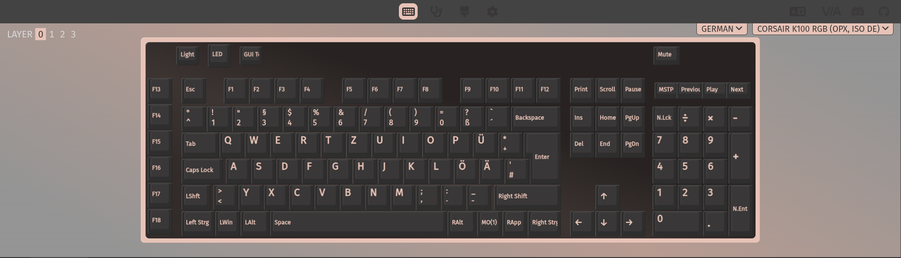

# k100-qmk

**QMK and VIA on the Corsair K100 RGB** — OPX optical, ISO DE — in place of Corsair's own
firmware.



That is this firmware, read over USB by the VIA application. The layout it is drawn from is
generated out of Corsair's own tables and ckb-next's geometry rather than written by hand,
down to the shape of the ISO enter.

**Working on the hardware:** typing, 190 LEDs, the iCUE wheel setting the brightness and the
volume roller setting the volume, the six status icons, and VIA reading and writing the
keymap, the layers and the lighting. Three separate ways back into Corsair's bootloader if a
flash goes wrong, all three measured.

**Installed over USB**, with no programmer and the case shut: `Fn+Esc` hands the keyboard to
Corsair's own bootloader, and `k100-bragi flash` writes this firmware through Corsair's own
update path. See [Installing it](#installing-it).

**Not finished:** two of VIA's four layers are not reachable, because no key selects them,
and nothing has been watched switching NKRO off and on. What has never been exercised is a
recovery of a keyboard that really would not boot: both parts of that are proven, including
on a keyboard running this firmware, and the keys that do it are read by the bootloader before
any firmware of ours runs -- but nobody has yet had to put them together in anger.

---

## ⚠️ Read this before writing anything to a keyboard

**Using anything in this repository is entirely at your own risk.**

- **This has already bricked a K100.** Not hypothetically. A custom image was flashed whose
  route back to the bootloader had never been observed working, and which called that route
  *before* the held-key escape hatch. The call faulted, both ways back were lost together, and
  the keyboard stopped enumerating entirely — no USB at all, and no key held at power-up
  changed that. Recovering it took opening the case and wiring a programmer to the board. The
  post-mortem is in [`docs/recovery.md`](docs/recovery.md) and the procedure that got it back
  is in [`swd/`](swd/README.md). **It need not have.** Corsair's bootloader keeps the keyboard
  if `B` and `L` are held while it is plugged in — decoded out of the bootloader and measured
  since. The key tried at the time was Escape, which is the one key that guarantees the
  opposite.
- **You can permanently destroy your keyboard.** The K100's MCU can ship with read-out
  protection and debug access disabled, in which case a failed firmware write leaves no way
  to recover it. This is not a theoretical risk; it is documented for this chip family.
- **No warranty, no guarantee, no support.** Not of correctness, not of fitness for anything,
  not that any procedure described here will do what it says.
- **This will void your warranty** and is not endorsed by or affiliated with Corsair in any
  way.
- **The protocol findings are reverse-engineered** from Corsair's own publicly served
  software and from [ckb-next](https://github.com/ckb-next/ckb-next). They are inferences
  about undocumented behaviour and some are explicitly marked as unconfirmed.

If you are not willing to lose the keyboard, **do not write anything to it.**

Read [`docs/recovery.md`](docs/recovery.md) first. It explains what is and is not recoverable,
and the two rules that keep a mistake survivable.

---

## Where it stands

### On the keyboard

| Area | State |
| --- | --- |
| Working firmware | **Yes.** It runs from flash, enumerates, binds three HID interfaces, types and lights. Typing was measured at 5204 key events across four minutes of continuous use. It used to hang within a second of being used; the cause was a system-timer priority that is not a priority on a part with three priority bits, which put the tick above the kernel's own interrupt mask. [`docs/scheduler-stall.md`](docs/scheduler-stall.md) |
| ChibiOS LPC546xx port | **Runs on the keyboard.** Boots through `crt0`, `halInit()` and `chSysInit()` into QMK's main loop, from SRAM and from flash alike. |
| USB | **Working.** Enumerates at 480 Mbit/s as `1b1c:1b7c`, `bcdDevice 0030` for version 0.3.0, and the kernel binds all three HID interfaces. |
| QMK layout, keymap and VIA definition | **Generated**, not written, from ckb-next's geometry and the stock firmware's own tables; a fresh run reproduces all three files byte for byte. The definition names the keycodes this board adds and carries a lighting menu holding the effects this firmware is *built* with -- VIA's own menu sends a position in a list of all 45, which is a different number. `tools/via-definition-check` runs it through the same reader the application does before a browser ever sees it. [`docs/qmk-layout.md`](docs/qmk-layout.md) |
| Key matrix pins | **Proven on hardware**, read against `bcdDevice` so it is this firmware and not the bootloader's own keyboard: 67 presses across 16 keys while the device reported `0.01`. The settle time is 500 us -- these are optical switches, and the 20 us first guessed is far too short for an emitter and phototransistor to answer. [`docs/pin-mapping.md`](docs/pin-mapping.md) |
| The two rotary controls | **Both work.** Neither rotation is matrix-scanned, so they are encoders on `P1_28`-`P1_31`, read out of the stock firmware's pin-interrupt configuration. Which pair is which was a guess from the order the image's own tables list them in, and turning them confirmed it: wheel to the brightness, roller to the volume. The roller came out inverted, so its two cases are crossed in `encoders.c` -- `ENCODER_DIRECTION_FLIP` would have turned the wheel round with it. |
| Lighting | **Working.** 190 LEDs across three IS31FL3743B drivers on SPI3, settable like any other QMK keyboard. It stayed dark long after the bus, the pin mux, the frames and the enable outputs had all been matched against Corsair's own firmware while that firmware was lighting the keyboard. What was missing was a function register at `0x25`, written differently for one of the three drivers: these parts take their scan timing from one of their number, and a set in which every one is told to follow has nobody leading. [`docs/pin-mapping.md`](docs/pin-mapping.md) |
| Keymap | **Six macro keys and a working Fn layer.** Remappings and macros now outlive an update, which they did not: VIA resets them whenever the firmware's build date changes, and this keyboard names its own marker instead. G1 to G6 are VIA's first six macros, read back from the keyboard as `0x7700` upwards and seen typing what was recorded into them. The keyboard reports 16 macros and 855 bytes of storage, which is what the 2 KB EEPROM region has left once the dynamic keymap for an 8 by 18 matrix is in it. Fn+Esc reaches Corsair's bootloader and Fn+Backspace clears the stored settings, both because nothing else can; Fn+Left and Fn+Right set the effect speed, which has no control of its own on the board, and were seen doing it. Fn+N toggles NKRO: the keycode is stored, the toggle itself has not been watched. Every one of these cost a move of `EECONFIG_MAGIC_NUMBER`, because the keymap the firmware reads is the stored one. |
| Lighting controls | **Split between the keyboard and the application, with one owner each.** The wheel button steps the effects the firmware was built with, the wheel sets the brightness, and the colour belongs to the one effect that is a colour -- this keyboard's rainbows paint their hues fully saturated, because QMK's own keep the saturation of the plain colour and a keyboard set to white therefore had white rainbows. Anything the keyboard changes by itself is announced to the application: VIA reads its menu values when it connects and otherwise knows only what it wrote, so `via_ui_sync.c` asks it to read them again. |
| Effects | **Six, and two of them react to typing.** A rainbow that moves the whole board through the hues and one that sweeps across it, the plain colour, an "Off" that paints black so the status icons survive it, the painted keyboard itself, and the reactive pair: a key that lights and fades where it was pressed, and a ring that spreads out from it. Both are one piece of arithmetic -- a press is a wave, and the two differ only in how far an LED counts as being from it. What a key reacts *in* is a choice: the painted colours, so a keyboard somebody has painted reacts in their own, or one colour of the reaction's own. Never the plain colour's, which is one knob reaching across effects and a fault this keyboard has already had. |
| What the lighting costs | **Measured, not assumed.** The keyboard counts its own frames, its own main-loop rate and how many presses it is still remembering, and reports all three in VIA's Diagnostics menu; `tools/via-lighting.py --measure` walks every effect and reads them. With the press ring full: 29 fps at 239 Hz for the plain colour, 28 at 229 for the reactive fade, and 25 at 209 for the splash -- about 12% of the loop, which is one square root per LED per remembered press and the dearest thing this firmware draws. Both numbers falling together is what says the arithmetic is the cost rather than the frame pacing. It matters here more than on most boards: the matrix alone costs 4 ms a scan, because an optical switch needs 500 us per strobe to settle. |
| Lighting the application sets | **A colour for every LED, and it stays put.** Keys are painted one at a time with VIA's own key painter; the 55 lights that are not keys -- the three LightEdge bars, the ring around the wheel, the logo -- have a colour and a brightness each, because the painter only paints what it draws. Each stored colour carries its own brightness, which is the only way to say that one key is *off*: zero saturation is white, not dark. Caps, Num and Scroll Lock light their own keys in a colour of the user's choosing. All of it survives an update now: VIA keys its stored data to the build date, so a patch lets this keyboard key it to the number that actually means "the shape of what is stored changed" instead. When that number does move, `tools/via-per-key.py --dump` and `--load` carry the colours across -- proven byte for byte around the move that introduced the lock colours. |
| Status icons | **Four of the six report something true.** Num, Caps and Scroll Lock from the host; Win Lock is the keyboard's own GUI lock, and setting that state over SWD takes the icon's channel to `0xff` and back. Mute stays dark deliberately -- a keyboard is told about locks and nothing else, so lighting it from our own volume keys would report what was last asked for rather than what is so. They survive the lighting being turned off, which took an effect of our own: QMK draws indicators only while an effect runs, and its way of having none stops the lighting task, so "Off" selects an effect that paints black. |
| Which LED belongs to which key | **Measured, one LED at a time.** Three derivations were tried and all three were wrong: ckb-next's order, the key matrix, and the physical rows. What the keyboard says is six rows of 22 slots, each starting with a macro key, with the media keys in the top row where they are printed and the number pad's 1, 2, 3 before its 4, 5, 6. Six slots carry no LED and still take their numbers. The lights that are not keys were measured the same way: the wheel's ring, the three bars of the LightEdge, the logo and the six status icons. The probe that settled all of it is in VIA's Diagnostics menu and is part of this firmware. |
| VIA | **The application configures this keyboard**, as in the picture above. Protocol version 13, over the control endpoint: the interrupt OUT endpoint this keyboard should use takes a packet and answers it but never gives the host an acknowledgement it accepts, so the interface declares none and the host sends `SET_REPORT` instead -- an ordinary shape for an HID interface. Three defects in the shared LPC USB driver were found and fixed on the way, and a fourth was ours: the interface held one request, so a host that sent a second before reading the first answer lost one, and the application then read every answer one question late and gave up. `tools/via-sequence.py` reproduces that in six commands. [`docs/usb-bringup.md`](docs/usb-bringup.md) |

### Getting it on and off the keyboard

| Area | State |
| --- | --- |
| Firmware container format | **Proven.** The writer rebuilds both official images byte for byte. |
| Firmware distribution | **Understood and verified.** Official images download and validate. |
| Reflashing a *healthy* keyboard | **Proven on hardware**, in both directions. Corsair's own images, many times; and this firmware, over USB through Corsair's update path, with no programmer: `Fn+Esc` into the bootloader, 33828 bytes in 555 chunks, applied, and the keyboard came back as `bcdDevice 0010` with its three interfaces. |
| Route back to the bootloader | **Three ways, all measured.** From the keyboard alone: hold `B` and `L` while plugging in, decoded out of the bootloader's own startup matrix scan. From the firmware: `Fn+Esc` forces a watchdog reset, because `WDTOF` — the flag such a reset leaves behind — is what the bootloader keys on, not the EEPROM mode word this project first read it as. Over SWD it is one command. [`docs/recovery.md`](docs/recovery.md) |
| Recovery from firmware that will not boot, over USB | **Both halves are proven, the whole has never been needed.** Holding `B` and `L` while plugging in was decoded out of the bootloader's own startup scan and then measured **with this firmware installed and eleven minutes into a session**: the keyboard came back as `bcdDevice 000a`. That it works regardless of what the application is doing follows from where the decision is made -- the bootloader scans those two keys before it starts anything, so a wedged application never gets a say. Writing from there is `k100-bragi flash`, which has replaced this firmware over USB many times over. What nobody has done is the two together on a keyboard that really would not boot. The firmware's own route back also works, and for a while worked rather too well, firing on every cold boot because it could not tell a host that had not woken up from a broken one. Relying on any of this before it had ever been seen to work cost a keyboard. |
| Recovery from firmware that will not boot, over SWD | **Proven on hardware.** A bricked K100 was dumped, erased and restored to stock with a Raspberry Pi and four jumper wires. [`swd/`](swd/README.md) |
| Corsair's bootloader | **Dumped.** 64 KB read out over SWD and checked: its vector checksum is valid, so the image is complete. Not redistributable, so not in this repository. |
| Bragi protocol | **Command set recovered and the write path exercised** on a real unit. |
| Telling our firmware from Corsair's | **Only `bcdDevice` does it.** Corsair's bootloader presents a working keyboard of its own under the same vendor and product id, so typing proves nothing on its own. A whole 104-key sweep was once collected from the bootloader and credited to this firmware. `tools/watch-input.py` now refuses to attribute keystrokes it cannot place. |
| Test hardware | **One K100**, running this firmware, with its SWD header wired to a Raspberry Pi. |

Start with [`NOTES.md`](NOTES.md) for the research and
[`ARCHITECTURE.md`](ARCHITECTURE.md) for the plan.

## Hardware

Corsair K100 RGB, wired, **NXP LPC54605J512** (ARM Cortex-M4, 180 MHz, 512 KB flash).

| Variant | USB ID | Platform |
| --- | --- | --- |
| OPX optical — the target | `1b1c:1b7c` | NXP LPC54605 |
| Cherry MX Speed | `1b1c:1b7d` | NXP LPC54605, byte-identical firmware |
| OPX optical, "later variant" | `1b1c:1bc5` | **NXP i.MX RT — a different platform** |

**`1bc5` is not a revision of this board, it is different silicon**, so none of this work applies
to it: not the ChibiOS port, not the pin mapping, not a single firmware address. Its firmware is
`Splinter_App`, an i.MX RT image running from external QSPI flash, where `1b7c`'s is `Heracles`,
an LPC54605 image running from internal flash. See `docs/firmware-format.md`.

The K100 Air is a different device again and none of this applies to it either.

## Layout

```
docs/          research write-ups; recovery.md is the one to read first
swd/           talking to the controller over SWD with a Raspberry Pi: recovering
               a keyboard that will not boot, and debugging one that does not yet
tools/
  fetch-firmware.py       downloads and verifies official firmware
  k100_container.py       Corsair's firmware container, read and written
  pack-firmware.py        wraps a build in that container; --verify proves it can
  k100-bragi/             Rust Bragi client: identify, mode transitions, flash
  extract-ckb-keymap/     dumps ckb-next's authoritative layout
  generate-qmk-layout.py  generates the QMK and VIA definitions
  via-definition-check/   checks the generated definition with VIA's own reader
chibios/       the ChibiOS-Contrib LPC546xx port, and its checks under test/
qmk/keyboards/corsair/k100/   generated QMK keyboard definition
via/                          generated VIA definition
udev/          rules so k100-bragi runs without root
flake.nix      dev shells: default, .#keymap, .#firmware, .#qmk
```

### Using it in VIA

The keyboard is not in VIA's own list of definitions, so the one in `via/` is loaded by hand,
once per browser profile. Open [usevia.app](https://usevia.app) in a Chromium browser --
Firefox has no WebHID and will never find the keyboard -- turn on **Show Design tab** in the
settings, and drop `via/k100-iso-de.json` onto the Design tab. The definition then lives in
that browser's storage and survives restarts.

**The web application, not the desktop one.** v3.0.0 is the last desktop release and it does
not get as far as drawing this keyboard; the web application is where the project kept going,
and it is the one this was measured against. `tools/via-definition-check` checks the
definition with the same reader the application reads it with, before a browser ever sees it.

## Installing it

**One command, no key press, and nothing to type while the keyboard is away.** With the case
shut. This does not replace Corsair's bootloader; it uses Corsair's own update path, which is
the same one their software uses.

```sh
python3 tools/k100-update.py k100-qmk-0.3.0.bin
```

It checks the image before it touches the keyboard, asks whatever is running to hand itself to
the bootloader -- this firmware answers VIA's bootloader jump, Corsair's own application speaks
Bragi, and a keyboard already in the bootloader needs nothing -- waits for it to come back, and
writes. `--dry-run` does the checking and says which route it would take.

That matters on a desk with one keyboard. The two steps it replaces are fine with a spare and
impossible without: the first takes the keyboard away and the second has to be typed on it.
The steps are still there to be taken by hand, which is what to do when something in the middle
needs watching: `tools/via-bootloader.py` for the jump, then `k100-bragi flash <image>
--device 0x1b7c --commit`, which without `--commit` is a dry run that checks the image against
the keyboard and sends nothing.

The keyboard reboots itself and comes back as `bcdDevice 0030`, which is this firmware's
version 0.3.0. The keymap, the lighting and everything else VIA stores live in the keyboard's
EEPROM and survive the write -- except when a release says otherwise, which it does when the
shape of what is stored has changed.

Install `udev/99-corsair-k100.rules` first, or run the write as root; see `udev/README.md`.

**If it does not come back**, hold `B` and `L` while plugging it in. Corsair's bootloader keeps
the keyboard -- it reads those two keys itself, before any firmware of ours runs -- and the
same command writes a working image over the broken one, finding the keyboard already where it
needs to be.
[`docs/recovery.md`](docs/recovery.md) has the whole account, and [`swd/`](swd/README.md) the
route for a keyboard that reaches neither -- that one needs a programmer and an open case.

## Building

The layout, the keymap and the VIA definition are **generated**, and the two inputs they are
generated from live outside this repository: ckb-next's source, for where each key and light
physically is, and one of Corsair's own firmware images, for the matrix and LED tables read
out of it. Neither is vendored -- the first is somebody else's GPL project and the second is
Corsair's copyrighted image -- so both are fetched:

```sh
git clone https://github.com/ckb-next/ckb-next ../ckb-next
tools/fetch-firmware.py --out fw/
python3 tools/generate-qmk-layout.py --ckb ../ckb-next \
    --firmware fw/Heracles_Application_Firmware_v0.35.288.bin
```

**A fresh run leaves the working tree unchanged**, which is the point of generating them and
is worth checking rather than believing: `git status` after that is the test. Everything the
generator knows that neither input does -- which LED index lights which key, measured one at a
time -- is in `LED_SLOTS` in the script, with the reasoning beside it.

```sh
nix develop          # Rust tooling
nix develop .#keymap # Qt, for the keymap extractor
nix develop .#firmware && chibios/test/check-registers.sh   # the ChibiOS port's checks
nix develop .#firmware && chibios/test/build-demo.sh        # build the port
nix develop .#qmk      && qmk/test/build-k100.sh            # build the keyboard firmware
```

The two build scripts fetch ChibiOS, QMK and NXP's headers themselves rather than this
repository vendoring them, so they are the build instructions as well as the build.

A QMK build is a bare `.bin`; the K100's bootloader starts an application from a header it
expects to find in flash ahead of it, so the build has to be wrapped before it means anything
to the keyboard:

```sh
tools/fetch-firmware.py --out fw/                      # Corsair's own images
tools/pack-firmware.py --verify fw/*.bin                # prove the writer against them
tools/pack-firmware.py .build/corsair_k100_default.bin \
    --elf .build/corsair_k100_default.elf --out k100.bin
tools/pack-firmware.py --check k100.bin                 # before going near the keyboard
```

To talk to the keyboard without root, install `udev/99-corsair-k100.rules`; see `udev/README.md`,
which also records why Corsair's web updater cannot be used on Linux.

## Licensing and attribution

GPL-3 by `LICENSE`, **except** for the files destined for ChibiOS-Contrib (Apache-2.0) and QMK
(GPL-2.0-or-later), the one tool that links against ckb-next (GPL-2.0-or-later), and one file of
NXP's (BSD-3-Clause). Each says so in its own SPDX header, which is the only thing that travels
with a file into another project.

**[`LICENSING.md`](LICENSING.md)** explains why each exception is necessary rather than merely
tidy, and `tools/check-licensing.py` fails if the files and that document disagree.

Protocol and layout knowledge derives substantially from
[ckb-next](https://github.com/ckb-next/ckb-next) and
[OpenRGB](https://gitlab.com/CalcProgrammer1/OpenRGB), both GPL. Corsair firmware images are
copyrighted and are **not** redistributed here — `tools/fetch-firmware.py` downloads them
from Corsair's own public endpoint instead.

Hardware findings credited to others:

- **[CAC2244](https://www.youtube.com/@cac2244)** — *"K100: Removal of original thick cord to
  use USB pass-through port as input!"*
  ([video](https://www.youtube.com/watch?v=MEwbK5u6r_k)). Teardown of the USB passthrough
  connector, and the source of the lead that its extra contacts may carry reset — which would
  make hardware ISP reachable without a full teardown. See
  [`docs/recovery.md`](docs/recovery.md).
